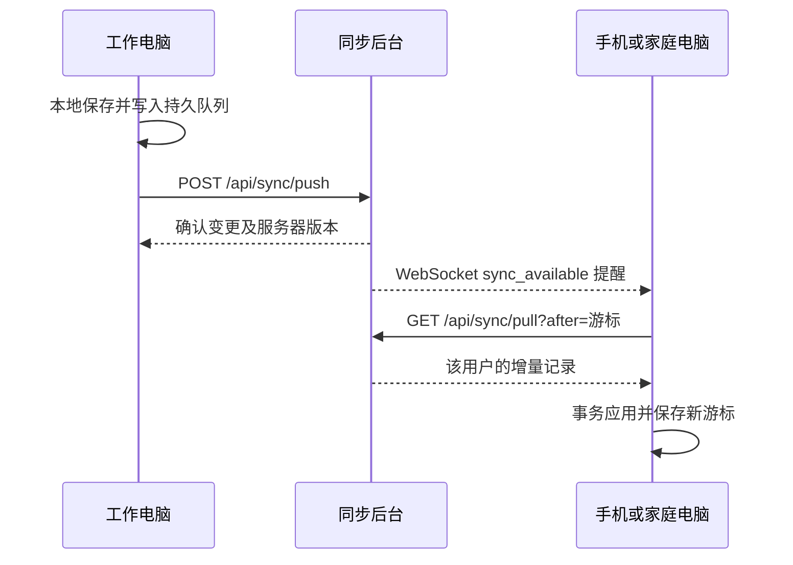

# 云同步调度、协议与后续推送

2026-11-01，Fly 2.0.7+43。本文描述当前实现；系统后台推送仅列为下一阶段，不包含 SDK、费用承诺或已完成标记。

## 本轮实际行为

| 触发 | 行为 |
| --- | --- |
| 已开启云同步且已登录，打开软件 | 恢复本机安全存储会话，立即进行一轮上传/拉取 |
| 手机从后台回到前台；电脑恢复前台 | 立即同步；手机重建连接，电脑复用已有引擎 |
| 创建、修改、删除业务数据 | 先写本地数据库和持久队列；约 250 ms 合并密集写入后同步 |
| 同一账号另一台在线设备有变更 | WebSocket 收到变更提醒后立即增量同步 |
| 没有收到提醒 | 每 5 分钟补查一次，属于前台运行期间的兜底 |
| 同步还没结束，又发生本地修改或收到提醒 | 合并为一轮后续同步，不丢掉触发，不并发重复跑整个同步 |
| 通知连接断开 | 2、4、8、16、32、60 秒重连，之后最多间隔 60 秒；成功收到有效提醒/心跳后重置 |
| 手机进入后台或关闭 | 断开常驻连接和前台定时器；本地队列不删除，回前台再补传 |

“立即”指触发网络同步，不承诺固定完成时间。断网时仍可操作，修改先保存在本机。手机连续三轮同步失败后沿用既有“三次失败停止”的规则；可点连接按钮或重新进入前台重连。未登录、已关闭同步或错误账号不会自动上传。

云端只传业务记录与文件信息，所有邮箱均不传图片或文件字节。本地电脑配对同步继续使用原局域网逻辑，轮询仍为 2 秒，文件下载续传与队列不变。绿色表示最近连接/同步周期成功，不等于所有实体文件已在本机。

## 消息提醒与数据传输的关系



WebSocket 是应用打开时的长连接，不是系统通知栏推送。提醒里只有类型与最新游标，不放客户正文、密码、文件或邮箱验证码。真正数据仍通过带 Bearer 会话的 HTTPS API 获取；令牌放请求头/连接后的首帧，不放 URL。

当前后台每条在线连接约每 2 秒检查该用户的最新变更序号，改变时才发提醒；空闲约 30 秒发心跳。客户端也启用 WebSocket ping 以识别失效连接。这里仍有服务端数据库检查，不能描述为已经接入消息队列或数据库发布订阅。用户量增长后，可将这部分替换成按用户汇总的提交事件和共享发布订阅，保留增量拉取兜底。

这种“首次获取＋长连接监听＋离线恢复”的方向可参考 [Firestore 官方实时查询说明](https://firebase.google.com/docs/firestore/real-time_queries_at_scale)。它证明的是一种成熟实现方式，不代表已经核实所有任务软件内部都使用相同协议。

## 为什么暂时不做后台推送

本轮满足“打开即最新、使用中及时更新”，不需要第三方推送费用。手机后台不能靠普通定时器稳定做到每五分钟唤醒；Android 的省电机制会推迟网络和同步任务，见 [Android Doze 官方说明](https://developer.android.com/training/monitoring-device-state/doze-standby)。iOS 后台更新也由系统调度，见 [Apple 后台更新文档](https://developer.apple.com/documentation/usernotifications/pushing-background-updates-to-your-app)。

建议先用真实用户验证前台同步体验。出现“关闭应用后还必须及时收到提醒”的明确需求，再接系统推送。后台提醒应当是提示应用检查新游标，不能成为数据正确性的唯一依据。

下一阶段预留事项（未开发）：

1. 服务端增加按用户及设备绑定的推送目标登记、更新和退出撤销；接第三方适配器，候选为 JPush，iOS 使用 APNs，Android 根据发行渠道配置对应通道。
2. 提交成功后合并短时间重复变更，只发“有新数据”的最小提醒，不在消息正文携带业务数据。
3. 收到后台提醒后，在系统允许的执行窗口调用现有增量接口；回前台仍无条件补查，不依赖提醒必达。
4. 真机核对不同设备、通知关闭、省电、强制结束应用、网络切换和令牌失效；然后根据实际覆盖与报价决定服务采购。

当前没有添加推送凭据、SDK、系统后台保活或通知权限申请。

## 实际 API 结构

基础地址 `https://world-workshop.cn/api`，通知地址 `wss://world-workshop.cn/api/ws`。官网与同步是两个独立服务；官网的 PHP 登录/授权账号与本次邮箱同步账号尚未统一。官网原 `/api/checkout`、`/api/activate` 继续交给 PHP，不属于下面的同步协议。

| 方法与路径（相对基础地址） | 用途 | 认证 |
| --- | --- | --- |
| `GET /health` | 健康和功能能力 | 无 |
| `POST /auth/registration/captcha` | 邮箱、用途换图形验证码 | 注册无；绑定需会话 |
| `POST /auth/registration/send-code` | 校验图形码后发送六位邮箱码 | 挑战 ID 与图形码 |
| `POST /auth/registration/verify-code` | 六位码换一次性注册证明 | 挑战 ID 与邮箱码 |
| `POST /auth/register` | 注册并签发设备会话 | 一次性证明与确认密码 |
| `POST /auth/login` | 邮箱密码登录，创建独立设备会话 | 邮箱密码 |
| `POST /auth/link-email` | 临时空间绑定已验证邮箱 | 设备会话及绑定证明 |
| `POST /auth/refresh` | 轮换刷新会话 | 刷新令牌 |
| `POST /auth/logout` | 撤销当前设备 | Bearer |
| `GET /account/me`、`GET /devices` | 账号信息、设备列表 | Bearer |
| `POST /devices/{deviceId}/revoke` | 撤销本账号设备 | Bearer |
| `POST /sync/push` | 提交持久队列变更，按变更 ID 幂等 | Bearer |
| `GET /sync/pull?after=0&limit=100` | 按服务器游标拉增量 | Bearer |
| `GET /sync/bootstrap?after=0&limit=100` | 初次接入的分页拉取 | Bearer |
| `GET /sync/conflicts` | 历史候选审计兼容接口 | Bearer |
| `POST /sync/enroll-device` | 兼容一次性测试接入码 | 设备接入码 |
| `WS /ws` | 数据变更提醒和心跳 | 连接后首帧发访问令牌 |
| `/files/...` | 历史文件协议 | 当前云部署返回 403，不用于云端传文件 |

后台总是从会话确认用户与设备，不接受客户端任意指定他人的用户 ID。登录请求示例（以下全是假数据）：

```json
{
  "email": "demo@example.com",
  "password": "example-password-only",
  "deviceName": "Work PC",
  "deviceType": "desktop",
  "platform": "windows",
  "appVersion": "2.0.7+43"
}
```

响应包含 `accessToken`、`refreshToken`、`userId`、`deviceId`、`email`、`emailVerified` 和 `expiresIn`。其他 HTTPS 请求使用 `Authorization: Bearer <accessToken>`；刷新令牌每次使用后轮换，不能保存并反复用旧值。

增量上传 `POST /sync/push` 的形状示例如下。实际 `payload` 由客户端业务仓库生成，包含新建记录必需的时间、关联等字段；这里省略这些业务字段，不能直接当作手工创建完整客户的脚本。

```json
{
  "mutations": [{
    "mutationId": "b93b1046-49ee-4772-b5d5-50d014e6034b",
    "entityType": "customers",
    "recordId": "9c66a8d9-336a-4bfd-975a-eae9174c5890",
    "baseVersion": 0,
    "changedFields": ["name", "country"],
    "payload": {"name": "Example customer", "country": "Canada"},
    "operation": "upsert",
    "fieldClocks": {
      "name": [1793491200000, "b93b1046-49ee-4772-b5d5-50d014e6034b"],
      "country": [1793491200000, "b93b1046-49ee-4772-b5d5-50d014e6034b"]
    }
  }]
}
```

响应 `results` 按 `mutationId` 确认结果并包含服务器记录与版本。删除使用墓碑操作；同一变更重发不会重复创建。跨设备按已观察版本和字段时钟自动合并，不能直接用整张数据库或“最后一个联网设备”覆盖其他设备。

拉取返回形状：

```json
{
  "changes": [{
    "entityType": "customers",
    "recordId": "9c66a8d9-336a-4bfd-975a-eae9174c5890",
    "version": 1,
    "data": {"name": "Example customer", "country": "Canada"},
    "deletedAt": null,
    "fieldClocks": {},
    "seq": 42,
    "operation": "upsert",
    "changedFields": ["name", "country"]
  }],
  "nextCursor": 42,
  "hasMore": false
}
```

示例省略了服务器实际返回的字段时钟明细。客户端把数据和游标放同一数据库事务中；`hasMore=true` 时继续分页。序号不要求连续，也不应使用设备时间替代服务器游标。

通知示例是 `{"type":"sync_available","latest_cursor":42}`，空闲心跳为 `{"type":"heartbeat"}`。提醒可以重复、延迟或遗漏，因此数据层仍要幂等并按游标追赶。注册的具体字段、过期和频率规则见 [邮箱账号说明](../release/email_cloud_auth_20261101.md)；Ubuntu 配置见 [详细部署步骤](../../server/deploy/cloud_sync_20261101.md)。

实现入口：[调度引擎](../../lib/features/sync/services/sync_engine.dart)、[通知连接](../../lib/features/sync/services/sync_notification_service.dart)、[生命周期控制](../../lib/features/sync/presentation/sync_controller.dart)、[后台 API](../../server/app/main.py)。
