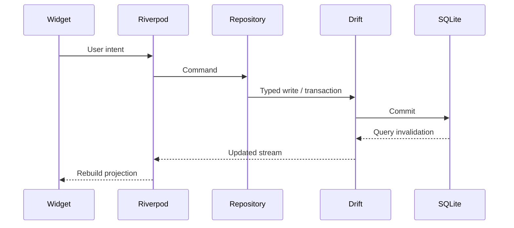

# Data Flow

## Create/edit task

## Projection consistency

Todo, Calendar and Matrix subscribe to different repository queries over the same `tasks` table. Calendar drag updates `dueDate`; Matrix drag updates `importance` and `urgency`; list reorder updates `sortOrder`. No view creates a duplicate task type.
