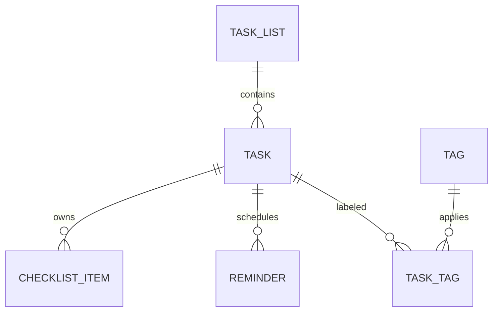

# Database

## Fly V1 schema

All business IDs are UUID strings except the stable built-in `inbox` list ID. Tables use `createdAt`, `updatedAt`, optional `deletedAt`, and `version`. Tasks also store `sortOrder`.

Foreign keys are enabled. WAL is requested for the on-disk connection. Indexes cover active tasks by due date, list/sort, importance/urgency, checklist task/sort and reminder task/time.

## Sorting

New tasks use gaps of 1024. The repository exposes a deterministic rebalance path when an ordered list is committed. A production refinement can use midpoint assignment for the common single move and rebalance only when gaps are exhausted.

## Migrations

Schema version is currently 1. Every future schema change must increment the version, provide forward migration tests, and preserve soft-deleted data until retention policy is explicit.
