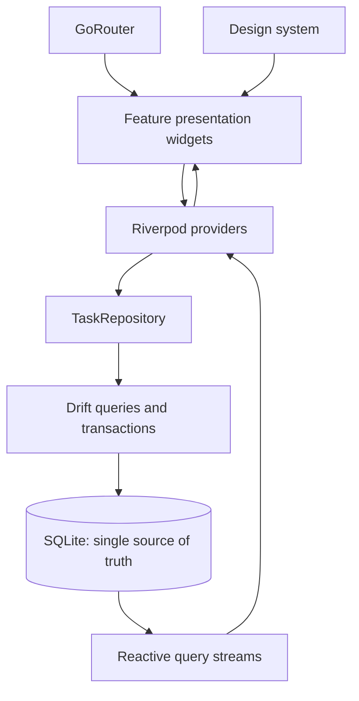

# Architecture Overview

Fly uses feature-first folders with moderate boundaries:

- `app/`: app root, routes and responsive shell
- `core/database/`: Drift schema, connection and migrations
- `features/tasks/`: domain, repository and task UI
- `features/calendar/`: Task date projection
- `features/matrix/`: Task importance/urgency projection
- `shared/design_system/`: visual tokens and themes

Widgets do not issue SQL. Riverpod is reactive application state, not a second data store.
