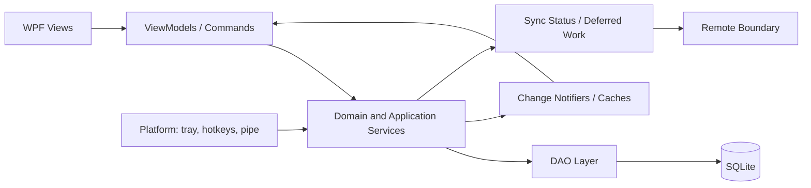

# Application Architecture

## Observed shape

The client is a layered desktop application rather than a collection of isolated screens. Views delegate meaningful changes to ViewModels and services. DAOs own persistence. Change notifiers and caches drive refreshes, while synchronization is downstream of local mutation.

## Major namespaces

The decompiled main application grouped concerns into Cache, Converter, Dal, Entity, Event, Framework, Models, Notifier, Resource, Service, SyncServices, UriScheme, Util, ViewModels, and Views. This is broad and mature, but also carries historical complexity.

## Design interpretation

- Persist first, then publish state changes.
- Represent Calendar and Matrix as task projections.
- Keep platform services at an edge.
- Preserve explicit service boundaries for multi-entity operations.
- Avoid importing the observed namespace count into a new V1; Fly uses feature-first modules and only one repository abstraction where it adds value.
