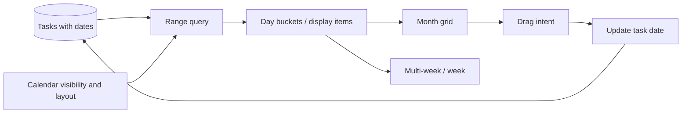

# Calendar Model

Calendar is a projection over tasks and calendar accounts, not a second task store. The observed UI uses CalendarDisplayViewModel, MonthGridViewModel, MonthDayViewModel, CalendarService, and drag helpers.

## Responsibilities

- CalendarDisplayViewModel owns current mode and navigation.
- MonthGridViewModel builds the visible date grid.
- MonthDayViewModel represents one date's display state.
- CalendarService resolves projections and updates.
- Drag helpers turn a target day into a task date change.

Fly V1 uses a month-bounded Drift query and derives day buckets in presentation. Dragging updates `Task.dueDate` in SQLite, so Todo and Matrix observe the same record.
