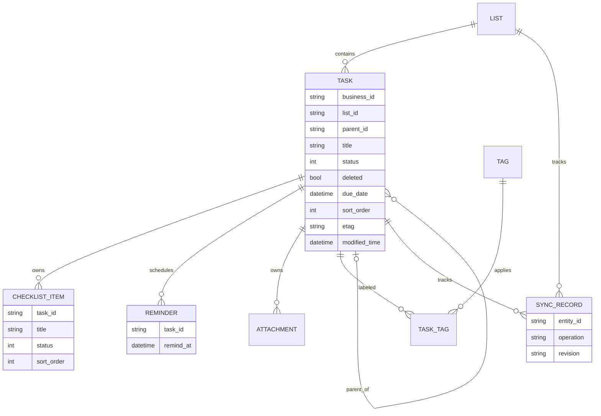

# Database ER Diagram

This is an architectural abstraction of the researched relationships, not a copy of proprietary schema DDL.

The key lesson is separation: main task fields, many-to-many tags, ordered children, scheduled reminders, and sync bookkeeping evolve independently.
