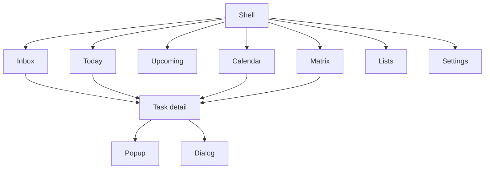

# Navigation Architecture

The researched client combines stable shell navigation with contextual detail and modal overlays.

Primary destinations change the workspace query. Selecting a task changes context without necessarily replacing the workspace. Popups and dialogs are reserved for bounded choices.

## Fly route translation

Fly defines addressable routes for `/today`, `/inbox`, `/upcoming`, `/calendar`, `/matrix`, `/list/:id`, and `/task/:id`. On expanded windows task selection opens the right detail panel; smaller windows can push the addressable task route. This preserves deep-link foundations without global navigation booleans.
