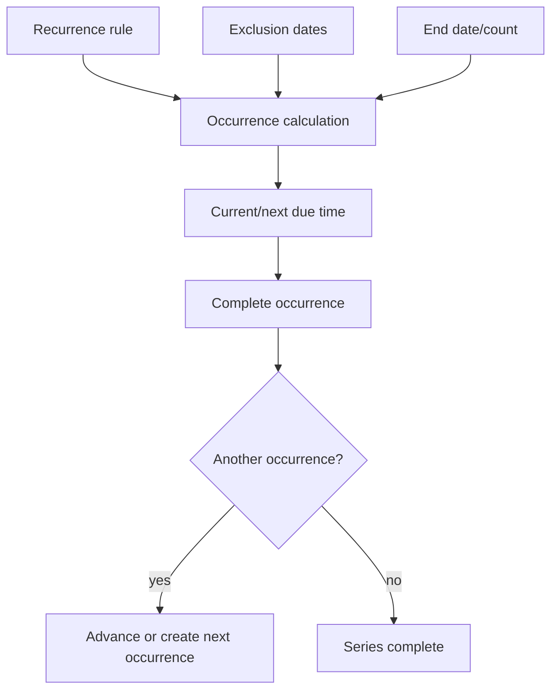

# Recurrence Model

The researched task model includes recurrence rule information, a recurrence origin, exclusions, and end conditions. Completion logic branches when a task repeats.

## Conceptual lifecycle

## Design requirements

- Preserve the original recurrence rule separately from a computed due date.
- Define timezone and all-day semantics explicitly.
- Track exceptions without rewriting the whole rule.
- Make completion behavior deterministic.
- Reschedule reminders when occurrence dates move.

Fly V1 reserves `recurrenceRule` and `recurrenceEndAt` on Task and offers simple repeat choices in detail UI. Full RFC-style calculation and exception editing are out of V1 scope.
