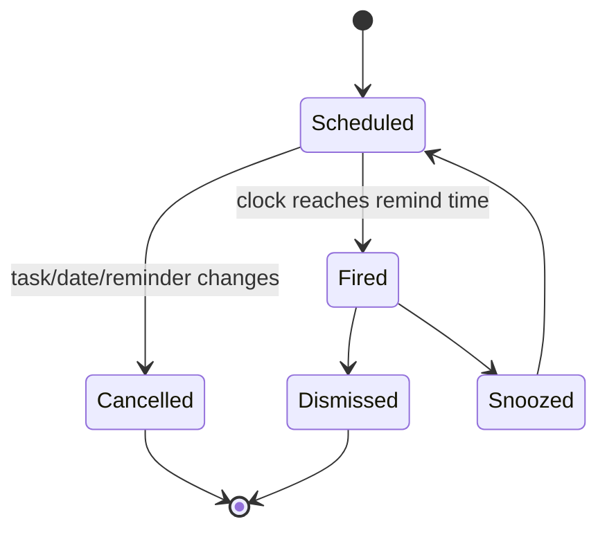

# Reminder Model

A reminder belongs to a task and has its own scheduling lifecycle. It is not merely a UI notification toggle.

## Observed integration points

Startup initializes reminder timing plus date, time, and timezone observers. Task changes can update related reminders. Recurrence may require reminders to be recalculated for the next occurrence.

## Fly lesson

Store reminder records separately from tasks, use soft deletion for replacement/removal, and derive OS scheduling from durable records later. Fly V1 persists one active reminder per task and exposes add/clear UI; native notification delivery and snooze are future platform-adapter work.
