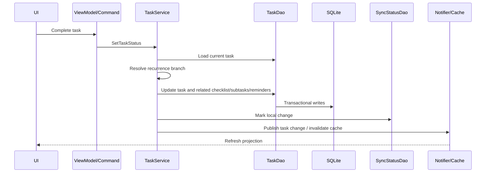

# Service Layer

Services coordinate operations that cross a single table or require cache, notification, or sync consequences.

## Complete-task example

## Observed responsibilities

- TaskService handles status transitions and recurrence behavior.
- CalendarService prepares calendar projections.
- DAOs handle concrete persistence.
- Notifiers prevent views from polling.
- SyncStatusDao records deferred remote work.

## Fly lesson

V1 needs less ceremony. Its repository coordinates task and child-entity writes directly in Drift transactions. A separate service should only be introduced when recurrence expansion, conflict resolution, or another truly cross-cutting workflow arrives.
