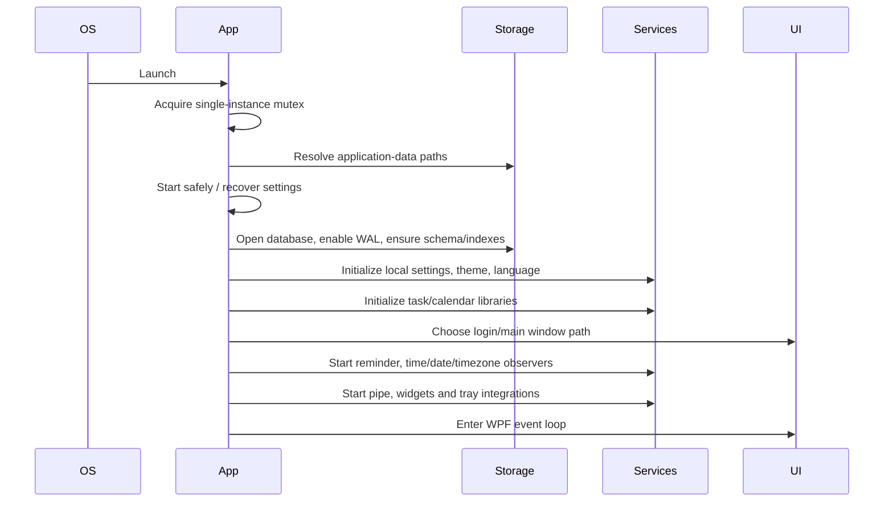

# Startup Flow

The installed client resolves data under the user's application-data area and uses a single-instance guard. Database readiness precedes the main experience. Background concerns are initialized after foundational configuration.

## Lessons

Startup should have a small ordered bootstrap with visible failure boundaries. Fly V1 keeps it shorter: initialize Flutter, open Drift, run schema setup, create the built-in Inbox, optionally seed debug data, then mount Riverpod and the router. No login or network gates exist.
