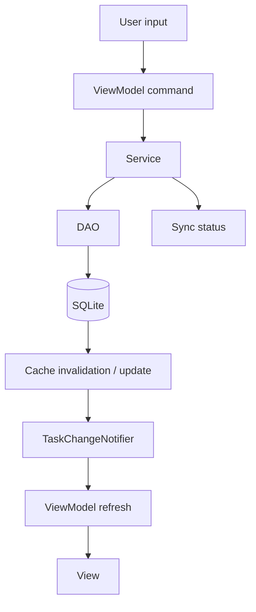

# State Management

Durable state, cached state, and presentation state are distinct.

## Operation example: complete task

1. The View sends a command rather than editing a row model in isolation.
2. TaskService reads current state and resolves recurrence.
3. TaskDao writes the task and related records.
4. SyncStatusDao records that local state changed.
5. caches/notifiers publish an update.
6. Task List, Calendar, detail, and other projections refresh.

## Fly translation

SQLite is the single source of truth. Riverpod holds application state and subscribes to Drift streams. Selected task, selected date, current month, and theme are ephemeral provider state; task records are never maintained as a second mutable in-memory database.
