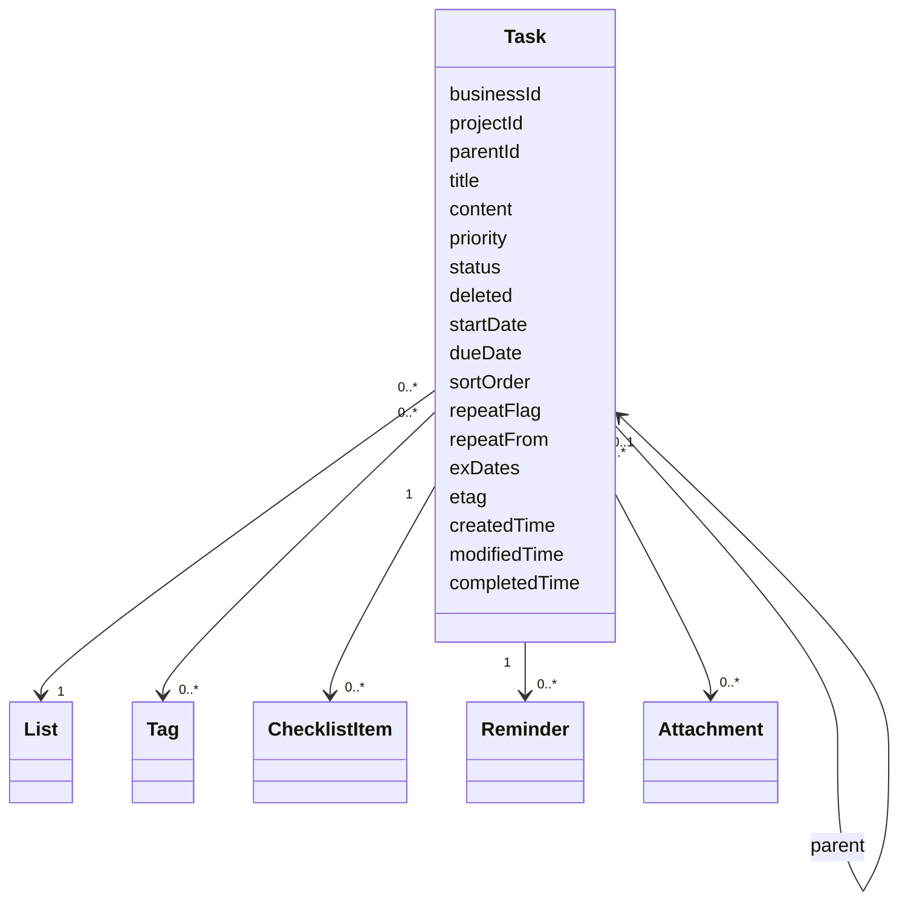

# Task Model

The researched model combines a local database identity with a string business identifier. It includes list/project and parent relationships, title/content, priority, dates, status, soft deletion, sort order, recurrence data, exclusions, reminders, checklist/detail children, tags, attachments, etag, and created/modified/completed timestamps.

## Conceptual model

## Design ideas

- Business IDs are stable beyond one database file.
- Soft deletion keeps sync history possible.
- Sort order is persisted domain data.
- Related collections are not packed into the main row.
- Server metadata is distinct from user-visible status.

Fly adopts UUID business IDs, soft deletion, versions, relation tables, and explicit sort order. It independently separates priority from matrix importance and urgency.
