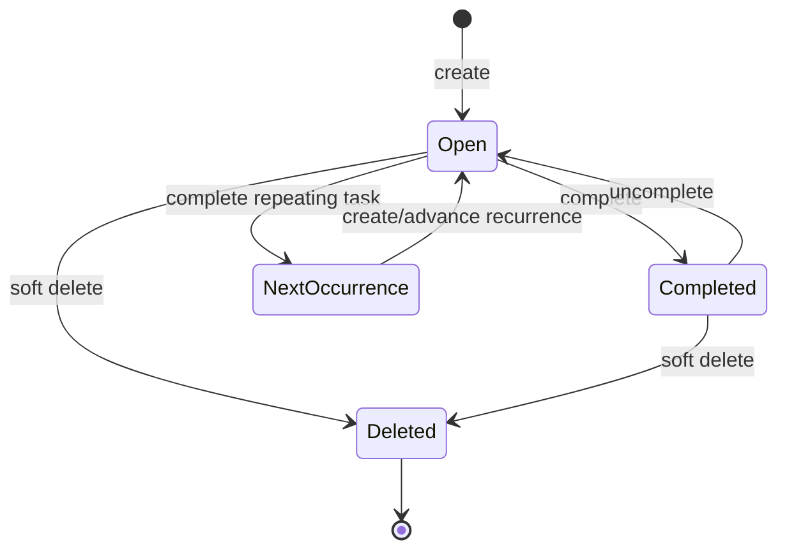

# Task State Machine

A visible status transition can also update completion time, checklist/subtask state, reminder scheduling, caches, notification channels, and sync status. Repeating tasks require a branch: completion may close an occurrence and prepare the next logical occurrence rather than permanently ending the series.

## Invariants

- Completion and soft deletion are different.
- Completed time must agree with completed status.
- Deleted records are excluded from ordinary projections.
- A state-changing command is idempotent where practical.
- All projections refresh from persisted state.

Fly V1 implements open/completed, uncomplete, and soft delete. Recurrence data is reserved, while full occurrence generation is deliberately deferred.
