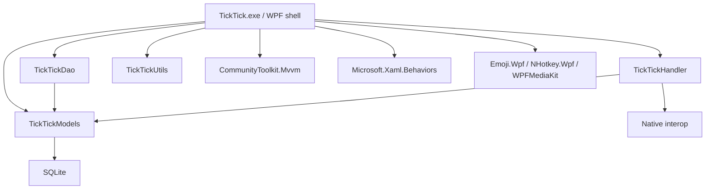

# Dependency Graph

## Reconstruction evidence

- `TickTickUtils`, `TickTickModels`, and `TickTickDao` built successfully.
- `TickTickHandler` reached C++/CLI and Kotlin-native interop errors.
- The main WPF project reached resource generation, then stopped on a missing `System.Resources.Extensions` requirement for preserialized non-string resources.
- Native `SmartDateDLL` was correctly identified as non-managed and was not treated as C#.

The graph explains why managed core assemblies can build while a complete executable remains blocked by native and resource edges.
