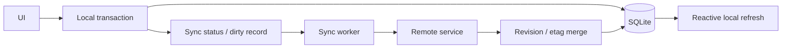

# Sync Architecture

TickTick is a local-capable client with deferred synchronization boundaries. A local user action does not wait for a remote round trip before the UI can reflect durable state.

## Observed concepts

Task models include server-facing identifiers and etags; DAOs and SyncStatusDao are separate; service operations enqueue or mark changes after local mutation.

## Design principles

- Local IDs remain stable before server assignment.
- Sync metadata is not overloaded into visible task status.
- Soft deletion represents a deletion that may still need propagation.
- Version/etag/revision support conflict detection.
- Changes are replayable and operations should be idempotent.

Fly V1 has no server and no sync worker. Its UUIDs, version, timestamps, and soft deletion deliberately leave a clean future path without pretending sync is implemented.
